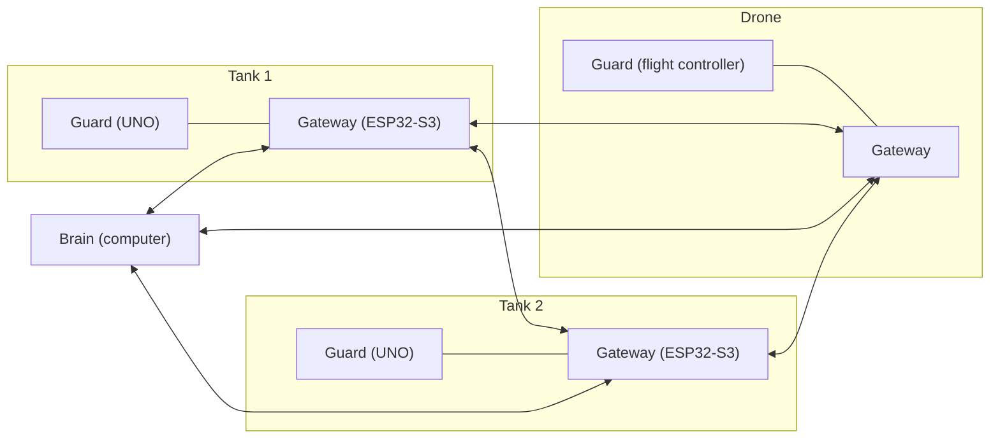

# Architecture

**Status:** agreed with the maintainer on 2026-11-11 and 2026-11-12, and recorded in [decision 0008](decisions/0008-architecture.md).

This page covers how the software is split across machines and how each part is built. It's sized for stage 2, increments 2 to 4, and it marks where it must grow for several robots, missions and other robot types. Input: the [vision](vision.md), the [requirements](requirements.md), and research report [R6](research/2026-11-09-embedded-firmware-architecture.md) on firmware architecture, cut down to what we need now.

## A1. Which machine does what

Three **roles**, not three fixed machines:

| Role | Job | Runs on today | Could run on later |
|---|---|---|---|
| **Guard** | Real-time control and safety: motors, stops, sensors, simple modes, heading hold, health counters | UNO | Any microcontroller, such as a drone's flight controller |
| **Gateway** | Connects the robot to the world: Wi-Fi, camera, messages to and from other robots and computers | ESP32-S3 camera board: the stock bridge in stage 2, our firmware from stage 3 | The same |
| **Brain** | Thinking: missions, combining behaviours, maps, vision, language | A computer | An onboard computer, or the camera board for small jobs (it has 8 MB of PSRAM) |



**Rules that make several robots possible:**

- **Robots talk to each other directly,** gateway to gateway, as well as to brains. A computer isn't required in the middle. Two tanks can share "I'm here, I see you" without one.
- **Every robot has an ID, and every message says who sent it and who it's for.** This is cheap to add now and expensive to add later. Drone protocols do the same: MAVLink gives every vehicle a system ID.
- **Only a robot's own guard decides what its motors do.** Others send requests, such as a mode, a goal or a speed, and the guard checks them. No peer, brain or mission can override a stop, and each guard stops on its own if its link goes quiet.
- **Missions are given as goals, not motor commands.** A brain says "explore this area" or "find tank 2", and each robot carries it out with its own behaviours.
- **Shared coordinates and a shared clock** are needed for maps and for "find each other": SI units and one convention for directions, as robotics does with ROS's REP 103.

**Logs are kept where there's room, and sent on when there's a link.** Drones do this with flight logs, and remote sensors with "store and forward":

| Where | What it keeps | When |
|---|---|---|
| Guard | A small fault memory: the last few faults with time and conditions, and counters such as resets and link timeouts. The UNO has 1 KB of EEPROM, so nothing more | Counters in telemetry from increment 2. Kept across power-off when we build fault memory (D11) |
| Gateway | Everything the guard reports, buffered in flash while no one is listening, and uploaded when a brain connects again | Stage 3, when we own the gateway. The stock bridge can't buffer |
| Brain | The full record from every robot, as JSON Lines ([0007](decisions/0007-testing-releases-and-traceability.md)) | From now, over USB, and over Wi-Fi in increment 4 |

Each message carries the robot's ID, its boot count and the time since boot. A brain lines these up with its own clock when it reconnects, so logs from several robots can be merged.

**The honest limit:** a stock tank doesn't know where it is. The gyro gives heading, but with no encoders, distance comes only from time and speed, which drifts quickly. Joint mapping needs positions: markers on the floor or walls that the camera can recognise, an overhead camera, or new sensors. That belongs to the "make it yours" stage, and the architecture leaves room for it.

## A2. How the UNO firmware is built

Four layers. Everything except the bottom one builds and is unit-tested on the host computer.

| Layer | Contents | Increment |
|---|---|---|
| **Modes** | Standby, remote driving, line tracking, obstacle avoidance, follow. One active at a time | 1 (remote driving), 3 (the rest) |
| **Services** | **Motion:** speed and heading hold. **Safety supervisor:** the only code that sets the motors; it checks every request and applies stops, arming, the battery and the link timeout. **Mode manager:** stops the motors on every mode change (S6). **Link:** the protocol. **Diagnostics:** see A5 | 1 (parts), 2 |
| **Devices** | One driver per part: motor driver, gyro, ultrasonic, line sensors, servos, LED, IR receiver, battery, button | 1 (motors, battery, button), 2 |
| **Hardware access** | Pins, timers, I2C, UART, watchdog: `hal/`, plus each device unit's files ending in `_hw.cpp`. Only this code touches registers, so everything else builds and is tested on the host computer | 1 |

- **One fixed 10 ms loop** (T1: 100 times a second). Each task gets a time budget, and no driver ever waits (T2). Aircraft systems often use the same "cyclic executive" for its predictability.
- **No RTOS on the guard, for now.** An RTOS would fit in 2 KB, just, but every task needs its own stack, and preemption brings races and priority problems that are hard to test. The guard's tasks are short and periodic, so a loop does the job. The gateway will run an RTOS anyway in stage 3, because the ESP32's Wi-Fi software is built on FreeRTOS. **Trigger for the guard:** a bigger microcontroller, such as the UNO R4's, with work that can't be split into short steps. Tasks with budgets map one to one onto RTOS tasks, so the move stays cheap.
- **Like AUTOSAR's layers, without its tooling.** Modes are the application, services are the basic software services, devices are the device abstraction and complex drivers, and hardware access is the microcontroller layer. We keep the layering and skip the generated runtime environment and ARXML configuration.
- **Every source of commands goes through the safety supervisor:** the computer, the IR remote, the MODE button, the modes and, later, missions. Any stop from any source wins, and driving again needs a deliberate new command, as it does today.
- **Behaviours combine on the robot by priority.** Modes are built from behaviours that run side by side, and a higher-priority one takes over when it must: "follow the line" runs, "obstacle close" outranks it and stops, and "no floor" outranks everything. This is subsumption, from Rodney Brooks' 1986 work, and it costs a few bytes, so combinations work even without Wi-Fi.
- **Missions and larger combinations happen in the brain,** with behaviour trees, the usual robotics tool for this. The brain sends goals and mode requests.
- **Health from the start, small:** reset causes, watchdog resets, link timeouts, I2C errors and battery sag under load, reported in telemetry. Diagnostics and prognostics grow from these numbers.

## A3. The computer side and the protocol

- **`host/` becomes a small Python package** with pinned dependencies and four parts: transports (USB serial now, Wi-Fi later, and a simulator), the protocol, a robot client, and the command line tool. People use the prompt; agents and tests use the same commands with JSON output (decision 0007).
- **Plug-and-play setup is one of its commands:** back up the stock firmware, flash ours, set up Wi-Fi and run a self-test, guiding the person only through the steps that need a hand.
- **A simulator comes cheaply,** because the firmware's logic already builds on a computer. Several simulated tanks would let us try "find each other" or "avoid each other" before owning a second robot. The trigger is the first mission work.
- **A hub process** that owns the link and lets several tools share it comes when we need it: in increment 4, or with a second robot.
- **The protocol: two links, decided separately.**
  - **Inside a robot** (guard to gateway), our small text protocol stays. In stage 2 it must pass through the stock bridge at 9600 baud, which only forwards text in braces.
  - **Between a robot and the world** (gateway to brains and peers), evaluate MAVLink in stage 3, when we own the gateway. It's open, designed for several vehicles of different kinds, and already handles IDs, missions and failsafes. Its drone focus may fit ground robots less well. ROS 2 is the other candidate, but it runs poorly on macOS.
  - **Now, cheaply:** add a protocol version and the robot's ID to the version message, and keep messages easy to translate later.

## A4. Repo structure

```
firmware/
  uno/                  the guard
    uno.ino             connects the units
    modes/  services/  devices/  hal/
      <unit>/           one folder per unit, such as services/battery/
        README.md       what it does, the requirements and checks it covers, its interface
        library.properties   its name and version
        src/            its code
        tests/          its unit tests, run on the host computer
        sim/  hil/      only when someone builds them
  testing/              the shared unit test harness
host/                   Python package for the host computer: transports, protocol, client, the `conq` command
  tests/                its unit tests
tests/robot/            robot tests, run by `conq` against a real robot or the simulator
scripts/dev.py          build, test, lint, upload
docs/                   vision, requirements, architecture, decisions, notebook, hardware
VERSION                 the product release's version (decision 0012)
```

- **Units are self-contained.** Everything about a unit lives in its folder, so it can be understood, tested, versioned and owned on its own, by a person or an agent. Google's Pigweed and the Zephyr RTOS organise embedded code the same way. `CODEOWNERS` can assign folders once there's more than one owner.
- **Each unit is laid out like an Arduino library.** We checked on 2026-11-11 that the Arduino build compiles a unit's `src/` and ignores its `tests/`, and that it reports the unit's version from `library.properties` in its JSON output. So every build log lists the version of every unit (D4).
- **Unit tests live in the unit; robot tests live in `tests/robot/`,** because they test several units together. Each unit's README links to the robot tests that cover it.
- **The command is `conq`,** short and clearly about the Conqueror. `oc` was rejected because it's already the name of OpenShift's command line tool.
- `firmware/camera/` joins in stage 3.
- **When a second robot type arrives,** firmware moves into a folder per robot, such as `robots/conqueror/` and `robots/<drone>/`. The protocol, host package, simulator and missions stay shared. Not before: we can't know the right split until there's a second robot.

### Supported systems

The robot's firmware is the same whichever computer built it. "Works on macOS, Linux and Windows" applies to what runs on the host computer: building, flashing, unit tests, `conq`, the simulator and later the hub.

| Tier | System | Guarantee |
|---|---|---|
| 1 | macOS | Everything, including the real robot. It's where we develop |
| 2 | Linux | CI on every pull request |
| 2 | Windows | CI on every pull request, plus a check with the robot before each release candidate |

If we ever need ROS 2, it runs in a container, so it works on all three.

## A5. Health: monitors, diagnostic events and signal status

Every sensor value needs a status as well as a value. Our ultrasonic reads its maximum, 150 cm, when no echo comes back, so a plain number can't tell "nothing there" from "I don't know". Faults also need one shared way to be confirmed and reacted to.

We use the standard terms, so the design is familiar to people from the field and to agents, and keep only the parts we need:

- **Monitors.** Each unit runs monitors on what it owns, every time it runs, and reports **passed** or **failed**: "the echo arrived in time", "the gyro answered", "the battery reading is plausible". Each monitor has an ID, listed in the unit's README. *Sources:* OBD-II monitors (SAE J1979), AUTOSAR's diagnostic monitors.
- **Diagnostic events and the diagnostics service.** One service, `services/diagnostics/`, debounces every monitor the same way, with a counter and thresholds per event. An event's status is **not tested**, **prefailed**, **failed**, **prepassed** or **passed**. *Source:* the debounce states in AUTOSAR Classic's Diagnostic Event Manager specification.
- **Reactions** come from one table, such as "gyro failed: heading hold off" or "ultrasonic failed: obstacle avoidance and follow unavailable", and stops go through the safety supervisor. *Source:* AUTOSAR's Function Inhibition Manager.
- **Signal status.** Every sensor value carries one of five statuses, and each leads to a different reaction:

  | Status | Meaning | Quality | The value holds | May be used by |
  |---|---|---|---|---|
  | **valid** | Fresh and trusted | good | The measurement | Everyone |
  | **init** | Started, no trusted value yet, such as the gyro calibrating at power-on | bad | The signal's init value | Nobody. Modes wait; it isn't a fault |
  | **substitute** | A replacement while a fault is confirmed or while it heals | uncertain | The last valid value, or a safe default chosen per signal | Control loops, briefly. Never safety decisions |
  | **error** | Fault confirmed | bad | The safe default | Nobody. Reactions apply |
  | **not available** | Not fitted, switched off or out of service | bad | Nothing meaningful | Nobody |

  The status follows the signal's diagnostic event: *not tested* gives **init**, *passed* gives **valid**, *prefailed* and *prepassed* give **substitute**, and *failed* gives **error**. A value that stops arriving needs no status of its own: a monitor checks that it updates in time, and the usual debouncing takes it to substitute and then error. Example: one missed ultrasonic echo holds the last distance as a substitute, several make it an error and obstacle avoidance unavailable, and when echoes return it stays a substitute until healed.

  *Sources:* quality (good, uncertain, bad) and the status codes `Bad_WaitingForInitialData`, `Uncertain_LastUsableValue`, `Uncertain_SubstituteValue`, `Bad_SensorFailure` and `Bad_NotConnected` in OPC UA (IEC 62541); the value status byte of fieldbus device profiles such as PROFIBUS PA, with "initial value", "last usable value" and "substitute value"; init and substitution values in AUTOSAR COM; the "error indicator" and "not available" values of SAE J1939.
- **Fault codes and fault memory** come later: confirmed events stored with snapshot data in EEPROM, and readable codes like the DTCs of UDS (ISO 14229-1) and OBD (D11). Device health for the user, such as "maintenance required", can follow NAMUR NE 107's four categories when prognostics arrive.
- **Cost:** a few bytes per event, about 100 bytes of RAM for thirty events, plus a status byte and one substitute value per signal.

**First iteration, in increment 2:** monitors for the units increment 2 adds (gyro, ultrasonic, battery, link), the diagnostics service with counter debouncing, a reaction table, signal status on sensor values, and event statuses in telemetry. Fault memory and fault codes wait until we've used this and know what we want from them.

## What this leaves for later

| Later | Trigger |
|---|---|
| Mission language and behaviour trees | The first mission, after stage 2's modes |
| MAVLink, ROS 2 or our own protocol between robots | Stage 3, when we own the gateway |
| Localisation: markers, an overhead camera or new sensors | Joint mapping or "find each other" on real robots |
| A hub process | Increment 4, or a second robot |
| A folder per robot type | A second robot type |
| Fault memory in EEPROM | Health monitoring needs history across power cycles (D11) |
| A signal description file that generates firmware and host code (D13) | The protocol grows, in increment 4 or stage 3 |
| A check that a changed unit's version was bumped | Units start being reused or released on their own |
