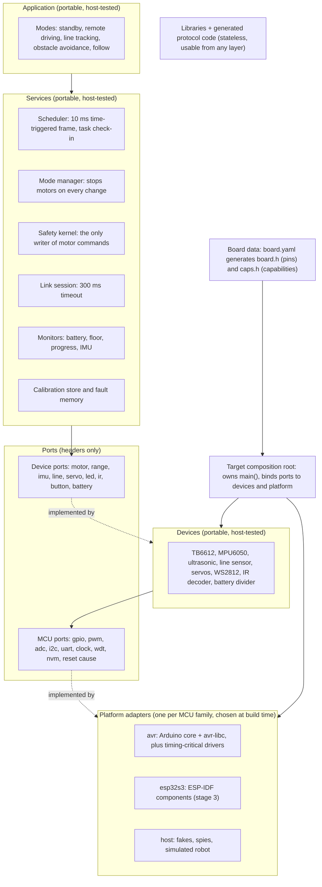

# R6: Embedded firmware architecture

**Background research from 9 November 2026, written before [decision 0006](../decisions/0006-walking-skeleton-first.md) cut stage 2 back to a walking skeleton.** Its recommendations are input, not decisions. Where a decision or the [architecture](../architecture.md) says otherwise, they win.

**In one line:** Build thin layers around one safety kernel.

Research date: 9 November 2026. Sources are cited inline. **[unverified]** marks a claim that no primary source confirmed during this research. **Estimate** marks design arithmetic, not measurement. **Inference** marks a design conclusion drawn from the sources rather than stated by them. "Read in source" means we read the open-source file ourselves. Nothing in this report was built, flashed or run on the robot.

The robot should use a **small, hand-built architecture shaped like AUTOSAR but not taken from it**. A portable core holds the application modes and services and knows nothing about pins. Device drivers for the TB6612, MPU6050 and the other parts are written against small port headers. Thin platform adapters cover the ATmega328P, the ESP32-S3 and the host computer, and each board's wiring is described as data. On the UNO everything is bound when the firmware is compiled and linked: **no virtual functions, no RTOS and no heap**. The reasons are that avr-g++ copies vtables into the 2 KB of SRAM, and that the FreeRTOS port for the UNO takes over the watchdog for its tick. A **time-triggered cooperative scheduler** with a 10 ms frame, driven by the Arduino core's existing millisecond counter, meets T1 and T2 and reports its own worst-case task times. **One safety kernel is the only code allowed to write motor commands.** On every frame it applies arming, the 300 ms link timeout, the speed limits and the monitors' inhibits. A dependency check in CI shows that nothing else can reach the motor port. A **64 ms watchdog** fed only when every task has checked in covers hangs. When the chip resets, the TB6612's internal pull-downs stop the motors. The stock **Optiboot 4.4 erases the reset cause** before our code runs, so markers kept in non-initialised RAM stand in for it until the planned bootloader swap. Hardware variants are built in from the start along two axes, the MCU platform and the board wiring, and a project-owned `board.yaml` generates the pin map and capability header. Per-unit versions (D4) come from a `unit.yaml` in each unit folder. The same file declares the unit's layer and allowed dependencies, so it feeds the version table, the dependency check and the agent instructions. The system split follows PX4 and ArduPilot: the UNO guards, the ESP32 routes and authenticates, and the computer plans and records. Testing runs in four tiers: host unit tests, a simulated robot on the computer, the real UNO binary in the simavr emulator, and a bench robot on a stand. The weak point is evidence. The AVR cost of the port style, the timer budget, the watchdog's behaviour with interrupts off, whether the markers survive a reset, and the pull-downs on this board are all unmeasured. Short spikes should settle them before the first driver is written.

## The recommended architecture fits on one page

The design has six layers inside each firmware image and three machines in the system. Each layer removes exactly one dependency, which is how AUTOSAR defines its own layers (inference from the definitions below). The diagram shows one image. The UNO, the ESP32-S3 and the host build the same core with different platform adapters and board data.



The system split puts each job on the machine that can do it safely. The drone precedent behind it is covered later in this report.

```
 Computer (macOS, Linux, Windows)
   Python hub: link, decode, record MCAP, serve views | planning, vision, language | tests, simulated robot
        |   commands and heartbeat at 10-20 Hz down, telemetry up
        |   stage 2: stock bridge, TCP port 100        stage 3: UDP / WebSocket, authenticated
 ESP32-S3 camera board   (stage 2: ELEGOO firmware unchanged; stage 3: ours)
   Wi-Fi and authentication | camera stream | frame-aware router | update gatekeeper | stops the UNO when Wi-Fi goes quiet
        |   UART: 9600 baud in stage 2, 250k planned for stage 3
 UNO (ATmega328P)
   safety kernel, 300 ms link timeout, watchdog | modes | sensors | calibration and fault memory
        |
 TB6612 -> two motors        (internal pull-downs hold standby whenever the UNO is in reset)
```

The folder layout gives each unit its own folder. Each folder holds a `unit.yaml`, a short `AGENTS.md`, its headers, sources and tests.

```
open-conqueror/
├── AGENTS.md                  rules for every agent and contributor (CLAUDE.md imports it)
├── firmware/
│   ├── core/                  portable C++17 + ETL, no hardware headers; host-tested to 100% MC/DC
│   │   ├── app/               modes
│   │   ├── services/          safety/, modes/, sched/, link/, monitors/, calib/, faults/, log/
│   │   ├── devices/           tb6612/, mpu6050/, ultrasonic/, line3/, servo/, ws2812/, ir/, battery/
│   │   ├── ports/             device ports and MCU ports (headers only)
│   │   └── lib/               crc/, fixed/, filters/  (stateless)
│   ├── platforms/
│   │   ├── avr/               MCU ports on the Arduino core; echo capture, IR edge timing, WS2812 output
│   │   ├── esp32s3/           ESP-IDF components (stage 3)
│   │   └── host/              fakes, spies, simulated-robot adapters
│   ├── boards/
│   │   ├── conqueror-v1.1-tb6612-uno/   board.yaml (pins, parts, capabilities)
│   │   └── host-sim/                    the same robot, simulated
│   └── targets/
│       ├── uno/               arduino-cli sketch + sketch.yaml profiles; composition root
│       ├── camera-s3/         ESP-IDF project (stage 3)
│       └── host/              CMake presets: unit tests, simulated robot
├── protocol/                  YAML description; generated code goes to build folders, not git
├── tools/                     Python package: hub, CLI, generators, layer check, version check
├── sim/                       plant and sensor models, simavr harness
└── docs/                      architecture.md (arc42-lite), decisions/, notebook/, hardware/
```

| Part | Recommendation | Main reason |
|---|---|---|
| Layers | app, services, devices, ports, platforms, plus stateless lib and board data | Each layer removes one dependency; everything above platforms is host-testable |
| Binding on the UNO | Port headers of free functions, implemented by link-time substitution; devices as templates on a config type | Zero RAM, no vtables, simple host builds |
| Variants | Two axes: platform (MCU family) and board (wiring and parts), from one generated board header | The pattern of ArduPilot, Marlin, Zephyr and QMK |
| Execution, UNO | Time-triggered cooperative scheduler, 10 ms frame, from `millis()` | Fits 2 KB, keeps the watchdog free, gives a provable time budget |
| Execution, ESP32-S3 | A few native FreeRTOS tasks around the same portable core (stage 3) | The SDK is built for it; RAM is plentiful |
| State machines | Hand-written enum and `switch`, one `change_mode()` that always stops first | Clearest for MC/DC, reviewers and AI agents |
| Safety | One kernel owns motor output; local 300 ms link timeout; 64 ms watchdog with check-in; start disarmed | Meets S1 to S6 without trusting anything upstream |
| Versions | `unit.yaml` per unit, generated flash table, release-time bump check; interface versions at every boundary | Meets D4 for about 4 bytes of flash per unit (estimate) |
| Dependencies | A Python layer check over `#include` lines, plus CMake and ESP-IDF visibility, plus import-linter | Works for all three build tools and in CI |
| Docs and agents | arc42-lite in Markdown, Mermaid diagrams, ADRs, AGENTS.md at the root and per unit | Renders on GitHub, read by most coding agents |
| System split | UNO guards, ESP32 routes, computer thinks | Same split as PX4 and ArduPilot |
| Testing | Host unit tests, a simulated robot, the real binary in simavr, a bench robot | Each tier catches what the cheaper one can't |

## Four layers, two axes and link seams keep the UNO's 2 KB intact

### AUTOSAR's layers are defined by what they hide, and that part scales down

AUTOSAR's public explainer of its layered architecture describes itself as "informative only". It targets "microcontrollers (typically 16 or 32 bit) with limited resources", not an 8-bit part like ours ([AUTOSAR CP Layered Software Architecture R24-11](https://www.autosar.org/fileadmin/standards/R24-11/CP/AUTOSAR_CP_EXP_LayeredSoftwareArchitecture.pdf)). What carries over is the way it defines each layer, by the dependency it removes. The **Microcontroller Abstraction Layer (MCAL)** exists to "make higher software layers independent of µC". The **ECU Abstraction** makes them "independent of ECU hardware layout", giving access to devices "regardless of their location … and their connection to the µC". **Complex Drivers** are the sanctioned escape hatch for devices "with very high timing constrains". **Services** provide mode management, non-volatile memory, diagnostics and watchdog or program-flow monitoring. **Libraries** "do not have internal states" and can be called from any layer (same source, pp.25–36). One "ECU" in AUTOSAR terms is one microcontroller with its software (p.21), so the UNO and the ESP32-S3 are two ECUs with separate configurations.

The tank maps onto this without the machinery. The **platform** layer is our MCAL: thin wrappers over Arduino core or ESP-IDF calls that implement MCU ports (`gpio`, `pwm`, `adc`, `i2c`, `uart`, `clock`, `wdt`, `nvm`, `reset cause`). The **devices** layer is the device half of AUTOSAR's ECU Abstraction. The TB6612, MPU6050, line sensor and the rest are written against MCU ports, so they are portable and host-testable with a fake I2C or a fake GPIO. The **board** layer is the wiring half: pins and fitted parts as data. **Services** and the **application** form the host-testable core. AUTOSAR's Complex Drivers become the few timing-critical pieces that must stay in the platform layer: time-stamping the ultrasonic echo, decoding IR edges and clocking out WS2812 bits (inference). The ultrasonic is the clearest case. The stock firmware blocks for up to 1 s on the ultrasonic and the servos ([requirements](../requirements.md)), which T2 forbids, so echo timing has to move to an interrupt that only records timestamps.

AUTOSAR also shows that abstraction can cost nothing. With one memory device, its `MemIf_Write` becomes "a simple macro which neglects the DeviceIndex parameter", and the module "does not exist" at run time. With two devices, a `const` array of function pointers routes calls, and the document concludes that "Abstraction Layers can be implemented very efficiently" ([AUTOSAR LSA, pp.98–105](https://www.autosar.org/fileadmin/standards/R24-11/CP/AUTOSAR_CP_EXP_LayeredSoftwareArchitecture.pdf)). Its configuration classes map onto variants. Pre-compile configuration uses `#define`s in a `*_Cfg.h`, which "results in most cases in more efficient code than access to constants or even access to constants via pointers" (pp.123–125). No authoritative public "AUTOSAR-lite" exists. The nearest open relative is **Eclipse OpenBSW**, a C++14 basic-software stack with a POSIX build for prototyping and a static board-support layer of ADC, PWM and CAN modules ([OpenBSW docs](https://eclipse-openbsw.github.io/openbsw/sphinx_docs/doc/index.html), [Eclipse project](https://projects.eclipse.org/projects/automotive.openbsw)). Its published targets are POSIX and a 32-bit MCU, and its footprint on an 8-bit AVR is unknown. We should **build our own** small version and borrow OpenBSW's ideas, not its code.

### Which AUTOSAR ideas transfer, and which don't

| AUTOSAR idea | Transfers? | Our version |
|---|---|---|
| Each layer removes one dependency (MCAL: the chip; ECU Abstraction: the board) | **Yes** | platforms remove the MCU; devices plus board data remove the wiring |
| Complex Drivers for timing-critical devices | **Yes** | Echo capture, IR edges, WS2812 output in `platforms/avr/`, behind ports |
| Interface, Handler and Manager roles | **Yes** | Ports are interfaces; the link session is a handler; the calibration store is a manager |
| Stateless libraries callable from any layer | **Yes** | `lib/` (CRC, fixed-point, filters) and generated protocol code |
| Pre-compile configuration in `*_Cfg.h` | **Yes** | Generated `board.h` and `caps.h` |
| Link-time configuration (one constant set outside the module) | **Yes** | Calibration defaults as one generated constant set |
| Cyclic main functions in a static schedule | **Yes** | The scheduler's static task table |
| "Only the scheduler uses OS services" | **Yes, adapted** | Only the scheduler and platform code touch timers and interrupt enables |
| ECU state and mode management | **Yes** | Startup sequence and mode manager |
| Watchdog manager with program-flow monitoring | **Yes** | Task check-in mask before each watchdog kick |
| NVRAM manager | **Yes** | A/B calibration slots with CRC and schema hash (from the [link report](2026-11-08-robot-link-protocol-and-diagnostics.md)) |
| Diagnostic event manager | **Partly** | A small fault memory with the ISO 14229 status byte (same report) |
| Development error detection, switchable at pre-compile time | **Yes** | Debug asserts compiled in for host and bench builds |
| Version info per module (`Std_VersionInfoType`) | **Partly** | Per-unit version table; no vendor or module IDs |
| Generated RTE and its XML (ARXML) toolchain | **No** | A hand-written header of typed signals, or a small generated signal table |
| OSEK/AUTOSAR OS with tasks | **No** | A cooperative scheduler on the UNO; native FreeRTOS on the ESP32 |
| Full COM, PDU Router, DCM and DEM stacks | **No** | One generated protocol and a UDS-shaped service, per the link report |
| Post-build configuration | **No** | No production-line reflash use case |
| Compile-time `#error` version checks between modules in one build | **No** | Everything compiles from one commit; checks only at image and process boundaries |
| Conformance classes and certification | **No** | AUTOSAR's ICC1 leaves the inner structure open anyway ([LSA, pp.85–86](https://www.autosar.org/fileadmin/standards/R24-11/CP/AUTOSAR_CP_EXP_LayeredSoftwareArchitecture.pdf)) |

### Link seams beat virtual interfaces on an 8-bit AVR

There are four ways to put a port between the core and the hardware, and only two of them are free on the UNO. **Virtual interfaces** are the most familiar and the easiest to mock. Embedded Artistry ran the same drivers unchanged on a macOS host, an nRF52840 and an STM32L4 behind abstract interfaces ([Embedded Artistry](https://embeddedartistry.com/blog/2020/11/23/real-world-portable-driver-examples/)). But avr-g++ puts vtables in SRAM. GCC bug 43745, "[avr] g++ puts VTABLES in SRAM", reports one user losing "50% of my RAM" to vtables, and a maintainer says a fix "needs extensions in the C++ front" ([GCC PR 43745](https://gcc.gnu.org/PR43745); **its current status is [unverified]**, because the tracker blocked automated access). GCC's named address space `__flash` works in GNU C only. Its documentation claims no C++ support ([GCC named address spaces](https://gcc.gnu.org/onlinedocs/gcc/Named-Address-Spaces.html)), and GCC 15's AVR notes add `__flashx` but say nothing about vtables ([GCC 15 changes](https://gcc.gnu.org/gcc-15/changes.html)). The UNO also builds with avr-gcc 7.3 for now ([toolchain report](2026-11-09-embedded-toolchain-and-build.md)).

**Link-time substitution** is the seam James Grenning teaches for embedded C. A module's hardware dependencies are handled "with interfaces, test doubles, and link-time substitution" ([Grenning, TDD for Embedded C, ch.8](https://oreilly.com/library/view/test-driven-development/9781941222997/f_0078.html)). Its known limit is one definition per symbol per executable, so a test that needs the real module and its fake goes into two test binaries ([CppUTest list](https://groups.google.com/g/cpputest/c/wK5DkB1Z2sw)). **Templates or CRTP** give static polymorphism with compile-time binding ([mbedded.ninja](https://blog.mbedded.ninja/programming/languages/c-plus-plus/designing-a-hal-in-cpp/)), at the price of header-heavy code.

| Port style | RAM on the UNO | Host test build | Coverage and review | Verdict |
|---|---|---|---|---|
| **Free-function port header, link-time substitution** | 0 | A different source list per target | Adds no branches to measure | **Recommended for ports seen by services** |
| **Templates on a config type** (`Tb6612<MotorPins>`) | 0, inlinable | Instantiate with fake types | Fine if kept shallow | **Recommended inside devices** |
| Virtual interfaces | One vtable per class copied to SRAM, plus a 2-byte pointer per object (inference from 16-bit pointers); about 150 B for 12 small interfaces (**estimate**) | Easiest: several fakes per binary | Easy | ESP32-S3 and host only |
| `const` table of function pointers (Zephyr `api`, AUTOSAR `WriteFctPtr[]`) | In SRAM unless placed with `PROGMEM` and read with `pgm_read_*` | Easy | Explicit | Only where several devices of one kind need runtime routing |

The recommended combination puts the binding in one place. Services call `ports/motor.h`, which declares `motor_set(left, right)` and `motor_stop()`. The UNO target's composition root implements those functions by forwarding to `devices::Tb6612<board::MotorPins>`. The host target forwards them to a spy. The services never see a pin, and the devices never see the board header. Whether `-flto` lets avr-gcc remove vtables when only one implementation exists is unknown, and a spike should measure it before ruling virtuals out completely (see the gaps below).

### Memory discipline is a rule set, not a library

Static allocation everywhere meets T8's "no dynamic memory" ([requirements](../requirements.md)). The toolchain report's common profile is C++17 with `-fno-exceptions -fno-rtti -fno-threadsafe-statics` and **ETL** as the heap-free container library, compiled with `ETL_NO_STL` on every target so host tests exercise the code the UNO runs ([toolchain report](2026-11-09-embedded-toolchain-and-build.md)). Three AVR-specific rules follow (inference from the GCC sources above). First, `const` tables land in SRAM on the ATmega328P unless placed in program memory, so they go behind a `ROM_TABLE` macro that expands to `PROGMEM` on AVR and to nothing elsewhere, with the read function in the platform layer. Second, the core stays free of `PROGMEM`, so it compiles unchanged for the host. Third, there are no log strings on the UNO at all, because the link report's log tokens replace them ([link report](2026-11-08-robot-link-protocol-and-diagnostics.md)). Zephyr's driver model uses the same split: build-time `config` in ROM, mutable `data` in RAM and a build-time `api` table ([Zephyr device model](https://docs.zephyrproject.org/latest/kernel/drivers/index.html)).

| RAM user on the UNO | Estimate |
|---|---|
| Link stack (UART rings, packet buffers, session, logs, calibration, faults), from the link report | 350–520 B |
| Scheduler: next-due times, check-in mask, worst-case-time counters for about 10 tasks | 40–60 B |
| Safety kernel, mode manager, monitors | 40–80 B |
| Signal table between services and app (about 40 signals) | 60–100 B |
| Sensor state (IMU raw and filtered, line, range, battery) | 40–70 B |
| Arduino core internals and the Servo library | unknown, to be measured |
| Stack peak | 250–350 B |
| **Total** | **about 780–1,180 B of the 1,536 B T8 allows (estimate)** |

The first build should report `avr-size` per unit so that measurements replace this table.

### Variants are two axes chosen at build time, from one board description

Every mature multi-board project the research examined picks the board **at compile time**, maps it to one folder through a single selection point, fails with `#error` on unknown boards and keeps most per-board variation in data files. ArduPilot takes `CONFIG_HAL_BOARD` from its build and runs an `#if/#elif` chain that ends in `#error "Unknown CONFIG_HAL_BOARD type"`. Its capability flags such as `HAL_NUM_CAN_IFACES` are `#ifndef` defaults, and some derive from flash size ([AP_HAL_Boards.h](https://raw.githubusercontent.com/ArduPilot/ardupilot/master/libraries/AP_HAL/AP_HAL_Boards.h)). That header has **no AVR backend left** (same source). Marlin, the live example of one codebase spanning AVR, ESP32 and more, keeps a folder per platform under `src/HAL/`, selected from compiler macros ([Marlin HAL](https://github.com/MarlinFirmware/Marlin/tree/bugfix-2.1.x/Marlin/src/HAL), [platforms.h](https://raw.githubusercontent.com/MarlinFirmware/Marlin/bugfix-2.1.x/Marlin/src/HAL/platforms.h)). It picks the board's pin header separately from a `MOTHERBOARD` setting, and retired boards produce an `#error` naming the replacement ([pins.h](https://raw.githubusercontent.com/MarlinFirmware/Marlin/bugfix-2.1.x/Marlin/src/pins/pins.h)). Zephyr names revision and variant in the target string `board@rev/soc/cluster/variant` and turns devicetree into compile-time `DT_` macros ([board porting](https://docs.zephyrproject.org/latest/hardware/porting/board_porting.html), [devicetree](https://docs.zephyrproject.org/latest/build/dts/intro-scope-purpose.html)). QMK gives each revision its own buildable folder and picks drivers by name in data ([QMK guidelines](https://docs.qmk.fm/hardware_keyboard_guidelines), [info.json](https://docs.qmk.fm/reference_info_json)). The Arduino core itself defines `ARDUINO_AVR_UNO` and `ARDUINO_ARCH_AVR` and keeps a pin-mapping folder per variant ([Arduino platform specification](https://arduino.github.io/arduino-cli/1.5/platform-specification/)). **None of them detects the board at run time.**

Marlin and ArduPilot both separate **the MCU family from the board wiring**, and so should we (inference). Our kit already has variants on both axes. The pin map is for the TB6612 shield V1.1, and "the DRV8835 shield uses different motor pins" ([pin map](../hardware/pin-map.md)). The camera board notes cover the ESP32-S3-WROOM-1 version, and "the ESP32-WROVER version differs" ([camera board](../hardware/camera-board.md)). A UNO R4 WiFi is the likely stage 5 platform ([roadmap](../roadmap.md)). A shield swap changes the board. A UNO R4 swap changes the platform and probably the board.

The mechanism should be **one project-owned `board.yaml` per board**, in the spirit of D13's machine-readable descriptions ([requirements](../requirements.md)). It names the platform, the pins, the fitted parts (`motor_driver: tb6612`) and the capabilities. A small Python generator turns it into `board.h` (pins, for the composition root and platform only), `caps.h` (constants such as `kHasLineSensor` or `kMotorHasStandby`, which the core may read) and the build selection for each tool. The toolchain report already chose the tools: arduino-cli `sketch.yaml` profiles for the UNO, ESP-IDF `sdkconfig.defaults` for the S3 and CMake presets for the host. It suggested exactly this kind of shared variant description ([toolchain report](2026-11-09-embedded-toolchain-and-build.md)). Because arduino-cli compiles every source in a library folder, device sources are wrapped in a guard on a generated macro (`#if OC_DEVICE_TB6612`) rather than chosen by file list. That works with every build tool (inference; how arduino-cli loads the core as a local library is still the toolchain spike's first task). Containment rules finish the job: only `targets/` and `platforms/` may include `board.h`, the core sees only `caps.h`, unknown boards hit `#error`, and CI builds every board so a variant can't quietly break. We should define two boards from day one: the real `conqueror-v1.1-tb6612-uno` and a `host-sim` board for the simulated robot. The second board makes any leak of pin knowledge into the core fail at once. DRV8835 and WROVER boards wait until someone owns the hardware to test them.

## A time-triggered loop beats an RTOS on 2 KB

### FreeRTOS and QP fail the requirements before they fail the RAM budget

| Option | Fit for T1–T2 and S4 | RAM on the ATmega328P | Licence | Verdict |
|---|---|---|---|---|
| Plain `loop()` running flat out | No time budget, jitter | Minimal | n/a | Starting point only |
| **Time-triggered cooperative scheduler** | Fixed frame, run-to-completion tasks, budget adds up | A few bytes per task | Our own code | **Recommended** |
| FreeRTOS (feilipu port, kernel 11.1.0) | Default tick is the **watchdog at 15 ms** | 192 B stack for the loop task alone, plus the idle and timer tasks; `heap_3` wraps `malloc()` | MIT | No |
| Protothreads | Cooperative | About 2 B per thread **[unverified]** | Varies | No: state hidden in macros hurts MC/DC and review |
| QP-nano or QP/C | Event-driven | QP-nano is sized for small parts | QP-nano is **discontinued**; QP/C is GPLv3 or commercial | No |

The FreeRTOS port for the UNO states that "normally, the ATmega Watchdog Timer is used to generate 15ms time slices". Using Timer0 instead breaks `millis()`, the `loop()` task gets a 192-byte stack and the heap is C `malloc()` ([feilipu/Arduino_FreeRTOS_Library](https://github.com/feilipu/Arduino_FreeRTOS_Library)). A 15 ms tick can't time a 10 ms task, and a watchdog running the tick can't also be the reset watchdog S4 needs. **That rules FreeRTOS out on the UNO before RAM does** (inference). QP-nano "has been discontinued … and is not recommended for new designs" ([QP-nano docs](https://www.state-machine.com/qpn/)). QP/C is GPLv3 for open-source use, and the derived application must also be GPL ([QP licensing](https://www.state-machine.com/licensing)), which conflicts with the project's Apache-2.0 decision.

The time-triggered cooperative pattern comes from Michael Pont's work. A periodic dispatcher runs tasks to completion without preemption, and later pattern papers cover migrating event-driven designs to it ([EuroPLoP 2009 paper](https://ceur-ws.org/Vol-566/f2_fnleuroplop2009.pdf)). An open-source Arduino version exists ([TTduino](https://github.com/chrispbarlow/TTduino)), but ours should be our own roughly 100-line unit, so that it can carry the watchdog check-in and timing statistics (inference). The design has a **static task table in flash** (function, period, offset), a **10 ms frame** for T1, a rule that **no task runs longer than 5 ms** for T2, and a per-task worst-case time and overrun counter sent as telemetry. T1 and T2 say "firmware reports its loop timing", so the scheduler is itself the test equipment ([requirements](../requirements.md)). On the host, the same task functions run against a fake clock, which makes timing logic unit-testable.

### Timer0 already ticks, so the scheduler shouldn't take another timer

The UNO's three timers are mostly spoken for. **Timer0** runs `millis()` and `micros()`, overflowing every 64 × 256 cycles, which is 1,024 µs at 16 MHz. We read this in the core's [wiring.c](https://github.com/arduino/ArduinoCore-avr/blob/master/cores/arduino/wiring.c) at `arduino:avr` 1.8.8. Timer0 also produces the two motor PWM signals on D5 and D6 at about 976 Hz ([pin map](../hardware/pin-map.md)). **Timer1** is claimed by the Arduino Servo library on the ATmega328P. We read this in its `ServoTimers.h`, version 1.3.0 ([Servo](https://github.com/arduino-libraries/Servo/blob/master/src/avr/ServoTimers.h)). That leaves **Timer2** as the only free timer, which makes it valuable for IR edge timing (inference). The scheduler should therefore poll `millis()` from `loop()` and dispatch due tasks, with no timer interrupt of its own. Interrupt handlers only capture timestamps or bytes and set flags. Multi-byte values shared with them are read inside `ATOMIC_BLOCK` from avr-libc's `util/atomic.h` (standard practice, **[unverified]** against the avr-libc page in this research).

With every pin in use, timing can't be measured by toggling a spare GPIO ([pin map](../hardware/pin-map.md)). `micros()` deltas with a running maximum per task are the realistic in-system method (inference; `micros()` resolution is 4 µs at 16 MHz **[unverified]**). Two interrupt-latency hazards need a number before the stage 3 baud rate is fixed. One is WS2812 output, which disables interrupts while it sends bits. The other is the AVR UART's two-byte hardware buffer, which overruns after about 80 µs at 250k baud (**estimate**, from the link report's byte times).

| Task | Period | Notes |
|---|---|---|
| Link receive, frame decode, session timeout | 10 ms | Stops are applied the moment they are decoded |
| Monitors, mode logic, safety kernel, motor output | 10 ms | Kernel runs last in every frame |
| IMU read and heading filter | 10 ms | I2C time to be measured |
| Line sensors (3 ADC channels) | 10 ms | |
| Ultrasonic trigger and result collection | 50–60 ms | Echo edges time-stamped by interrupt; no blocking |
| Servo targets, LED, battery filter | 50–100 ms | |
| Telemetry and log transmit | 100 ms | 10 Hz meets T7's stream rate |
| Calibration store to EEPROM | On request, motors stopped | A few bytes per frame |

### One central mode change makes S6 structural

| Option | Licence and status | AVR fit | MC/DC and review | Verdict |
|---|---|---|---|---|
| **Enum + `switch`, one `change_mode()`** | Our code | Smallest | Most transparent | **Recommended** |
| Table-driven FSM | Our code | Table in `PROGMEM` | Good | Alternative if modes multiply |
| StateSmith (diagram → C99/C++) | Apache-2.0, 0.22.2 (May 2026), no heap | Built for "tiny bare metal microcontrollers" | Generated `switch` code; the diagram is the review artefact | Good later option |
| Boost.SML | BSL-1.0, 1.2.0 (June 2026), C++14 header-only, has an AVR example | Needs standard headers that avr-gcc 7.3 doesn't ship **[unverified]** | Logic hidden in templates | No |
| tinyfsm | MIT, 0.3.3, no hierarchy | Plausible | Fair | No |
| QM / QP | GPLv3 or commercial | n/a | n/a | No |

Sources: [StateSmith](https://github.com/StateSmith/StateSmith), [NuGet 0.22.2](https://www.nuget.org/packages/StateSmith), [Boost.SML](https://github.com/boost-ext/sml), [tinyfsm](https://github.com/digint/tinyfsm), [QP licensing](https://www.state-machine.com/licensing). The toolchain report measured that **avr-gcc 7.3 ships no C++ standard headers** ([toolchain report](2026-11-09-embedded-toolchain-and-build.md)), which is why Boost.SML is flagged.

The robot has four driving modes plus standby (F5 to F8), and S6 says every mode change stops the motors first ([requirements](../requirements.md)). The simplest way to make that impossible to forget is a **single `change_mode(new)` function that always calls the kernel's stop, then the old mode's exit and the new mode's entry**. No other code writes the current mode, and the dependency check enforces that (inference). The state set is small and two-level: `Standby` (disarmed), `Driving{Remote, LineTracking, Avoid, Follow}`, and a latched `Failsafe` that only an explicit command clears. That gives S5 and the explicit-resume rule below without a library. StateSmith stays the upgrade path if the diagram should become the source of truth.

On the ESP32-S3 in stage 3, the native SDK is built on FreeRTOS **[unverified in this research]**, and the board has 8 MB of PSRAM ([camera board](../hardware/camera-board.md)). A few tasks (network, camera, UART bridge) joined by queues are the natural shape there. The bridge's own safety logic stays a portable, host-tested state machine.

## One function owns the motor pins

### The safety kernel turns requests into outputs, and nothing else can

Behaviours produce **requests**, and only the kernel writes the motor port. The kernel runs once per frame and applies its checks in a fixed order (inference, modelled on PX4 and ArduPilot arming and failsafe layers):

1. **Armed and mode check.** Disarmed means zero output. The robot boots disarmed (S5).
2. **Mode-change stop.** A pending mode change forces zero for at least one frame (S6).
3. **Link timeout.** No valid frame for 300 ms means zero for link-driven motion (S3).
4. **Monitor inhibits.** No progress for 2 s, floor lost, or battery under 6.4 V means zero and a fault code (S7 to S9).
5. **Limits.** The PWM is clamped so the average motor voltage stays at or below 6 V, using the measured battery voltage (S10), and the rate of change is limited.
6. **Output.** The result is written through `motor_set()`, or `motor_stop()` on any zero.

The checks hold only a few bytes of state. The dependency check makes the kernel's exclusivity provable. **Only `services/safety` may include `ports/motor.h`**, and CI fails any other include (inference). That is a cheap, honest safety argument on hardware where SG1 to SG3 rest on one channel.

PX4 and ArduPilot set the pattern for the link timeout. PX4 requires "a continuous 2Hz 'proof of life' signal" in offboard mode and takes a failsafe action when setpoints stop for `COM_OF_LOSS_T` ([PX4 Offboard](https://docs.px4.io/main/en/flight_modes/offboard.html)). When several failsafes fire, "the more severe action runs" ([PX4 safety](https://docs.px4.io/main/en/config/safety.html)). ArduPilot Rover's radio failsafe defaults to 1 s and its ground-station failsafe to 5 s. It treats "lost RC overrides in GCS-only operation" as a failsafe, and after recovery the driver must use the mode switch to retake control ([ArduPilot Rover failsafes](https://ardupilot.org/rover/docs/rover-failsafes.html)). Our 300 ms is far stricter, which suits a small robot at close range, but it needs a steady 10 to 20 Hz command stream ([link report](2026-11-08-robot-link-protocol-and-diagnostics.md)). Following ArduPilot, **a link timeout should latch**. Remote driving resumes only on a fresh, explicit drive command, never just because frames start arriving again (inference). Stop requests from any source (IR OK, MODE button, link, web page) win over everything (SG1). Which source owns driving when two are active is a decision for the maintainer.

The stop itself has two flavours on this driver. PWM low gives a short brake per motor, and STBY low makes both motors coast ([motor driver](../hardware/motor-driver.md)). A reset gives standby, so coasting is the hardware's fail state. Whether a commanded stop should brake first is a decision for the maintainer, and S1's 150 ms measurement should time both. One more input belongs on the S1 budget: the IR remote's own frame time eats into the 150 ms before the UNO even knows a key was pressed. If the remote uses an NEC-style code, that is roughly 68 ms **[unverified: the remote's protocol isn't documented in our notes]**.

### A 64 ms watchdog, fed only when every task checks in

The ATmega328P watchdog runs from its own 128 kHz oscillator. It offers timeouts from 16 ms to 8 s and three modes (interrupt, reset, and interrupt-then-reset), plus a `WDTON` fuse that forces reset mode. It is a simple watchdog with no window. The oscillator "is nominal at 3V and 25°C", so real timeouts drift with voltage and temperature ([ATmega328P datasheet](https://ww1.microchip.com/downloads/en/DeviceDoc/Atmel-7810-Automotive-Microcontrollers-ATmega328P_Datasheet.pdf)). In plain reset mode, a hang stops the motors when the reset fires, because every pin goes high-impedance and the **TB6612's internal 200 kΩ pull-downs on IN1, IN2, PWM and STBY** hold the driver in standby. That comes from its datasheet as recorded in [motor-driver.md](../hardware/motor-driver.md), and **confirming it on our board is still pending**.

| Timeout (nominal) | A hang stops the motors after | Margin over a 15 ms worst frame (10 ms + T2's 5 ms) | Verdict |
|---|---|---|---|
| 16 ms | about 16 ms | about 1× | Too tight |
| 32 ms | about 32 ms | about 2× | Tight given oscillator drift |
| **64 ms** | **about 64 ms** | **about 4×** | **Recommended start** |
| 125 ms | about 125 ms | about 8× | Inside S1 only if the oscillator runs close to nominal |
| 250 ms or more | 250 ms or more | | Breaks S1's 150 ms for a hang |

All figures are **estimates** from the datasheet's nominal values and must be measured on this chip at 5 V. The watchdog is kicked **once per frame by the scheduler, and only when every task due in that frame has set its check-in bit** (inference, matching the program-flow monitoring that AUTOSAR places in Services, [LSA p.28](https://www.autosar.org/fileadmin/standards/R24-11/CP/AUTOSAR_CP_EXP_LayeredSoftwareArchitecture.pdf)). A kick requested earlier than the frame allows is counted as a fault, which approximates the window the hardware lacks. Interrupt handlers never kick it.

**Interrupt-then-reset mode** adds a "last gasp". The first timeout runs the watchdog interrupt, which can drive STBY low and write a marker, and the second timeout resets. The datasheet warns not to re-arm the interrupt inside its own handler, because "this might compromise the safety-function" ([datasheet](https://ww1.microchip.com/downloads/en/DeviceDoc/Atmel-7810-Automotive-Microcontrollers-ATmega328P_Datasheet.pdf)). There is a catch that needs a test (inference). The switch to reset mode happens when the interrupt vector actually executes. A hang with interrupts globally disabled would therefore never take the interrupt, so it might never reach the reset. Plain reset mode has no such hole. The choice is diagnostics against coverage, and simavr, which models the watchdog ([simavr](https://github.com/buserror/simavr)), can settle the behaviour without touching the robot.

### The stock bootloader hides the reset cause, so markers stand in

On power-up the ATmega328P records the reset cause in `MCUSR` (power-on, external, brown-out or watchdog). After a watchdog reset the watchdog stays enabled, at its fastest timeout per avr-libc, so firmware must clear `WDRF` and disable the watchdog early or face "an eternal loop of time-out resets" ([datasheet](https://ww1.microchip.com/downloads/en/DeviceDoc/Atmel-7810-Automotive-Microcontrollers-ATmega328P_Datasheet.pdf), [avr-libc watchdog](https://avrdudes.github.io/avr-libc/avr-libc-user-manual/group__avr__watchdog.html)). avr-libc's recommended hook saves `MCUSR` into a `.noinit` variable from an `.init3` function before C startup.

Under our bootloader that hook sees nothing. **Optiboot 4.4 runs `ch = MCUSR; MCUSR = 0;` and jumps straight to the application unless the reset was external.** We read this in the copy shipped with `arduino:avr` 1.8.8, which our backup found identical to the robot's bootloader ([optiboot.c](https://github.com/arduino/ArduinoCore-avr/blob/master/bootloaders/optiboot/optiboot.c), [UNO backup](../notebook/2026-11-04-backing-up-the-uno.md)). The same source shows that its `appStart()` turns the watchdog off before jumping, so the reset loop is already prevented under the stock bootloader. It also shows that the bootloader uses RAM from address 0x100 as a page buffer only while writing flash (read in source). **Optiboot 8 passes the reset cause to the application in register r2, according to its documentation [unverified]**. The planned bootloader swap in the security report (R3, not published yet) would restore the true cause.

Until then, the reset cause comes from markers in `.noinit` RAM, which the C startup code doesn't clear (inference throughout this table; to be confirmed on the robot with the maintainer's OK):

| Reset | What the app sees under Optiboot 4.4 | How the markers tell |
|---|---|---|
| Power-on | `MCUSR` = 0 | Magic word and CRC invalid (RAM is random) |
| Watchdog | `MCUSR` = 0 | Valid magic, plus the "watchdog fired" flag written by the watchdog interrupt (interrupt-then-reset mode only) |
| Brown-out | `MCUSR` = 0 | Valid or invalid, depending on how far the supply fell; not distinguishable from external |
| External (button, USB port opened) | `MCUSR` = 0, after about 1 s in the bootloader | Valid magic, no flag |
| Requested by our firmware | `MCUSR` = 0 | Valid magic, plus a reason code written before the reset |

The startup sequence is fixed (inference, combining the sources above):

1. `.init3`: save `MCUSR` to `.noinit` and disable the watchdog. This is harmless under Optiboot 4.4 and correct under any other bootloader.
2. First thing in `setup()`: drive STBY, both PWM pins and both direction pins low as outputs.
3. Classify the reset from `MCUSR` or the markers, and record a fault code for any unexpected reset (D11).
4. Enable the watchdog at the chosen timeout.
5. Enter `Standby`, disarmed, and **never resume a driving mode after any reset** (S4, S5).

Repeated watchdog resets should latch a fault mode that refuses to arm until a person clears it (inference). The brown-out detector has 2.7 V and 4.3 V levels in the datasheet edition we read (a 1.8 V level on the commercial part is **[unverified]**). Brown-outs are plausible, because the motors draw from the same diode-fed battery supply as the UNO's input, and the servos and camera board hang off the UNO's 5 V rail ([power](../hardware/power.md)). Brown-out counts in the fault memory would show them (inference). The UNO's actual `BODLEVEL` fuse is unread, and the ICSP session in the security report is the moment to read it.

The honest summary is that the UNO is a **single channel**. The ESP32-S3 could act as a second, diverse stop path only if it could remove motor power on its own. On stock hardware it reaches the UNO over UART only ([pin map](../hardware/pin-map.md)), so a real second channel is a stage 5 hardware question (inference). Until then, the watchdog, the pull-downs and the local timeout are the whole safety case, which is why each needs a measurement.

## Version the boundaries, and let a script police the layers

### D4 is cheap to meet if versions live next to the code

AUTOSAR's pattern is published. Each module header carries `SW_MAJOR/MINOR/PATCH` and release macros, modules check each other's majors with `#if … #error`, and an optional `GetVersionInfo()` returns `Std_VersionInfoType` ([SWS BSWGeneral R25-11](https://www.autosar.org/fileadmin/standards/R25-11/CP/AUTOSAR_CP_SWS_BSWGeneral.pdf), [SWS StandardTypes](https://www.autosar.org/fileadmin/standards/R4.2.2/CP/AUTOSAR_SWS_StandardTypes.pdf); the exact current macro list is **[unverified]**, as the PDFs weren't opened). In a single-repo build where every unit compiles from one commit, those compile-time checks add nothing a git hash doesn't already guarantee (inference). D4 still asks for a version per unit ([requirements](../requirements.md)), and that has real value. It tells a reader of a recording or a fault report which driver revision produced it, without digging through git.

| Option | Robot reports | Cost on the UNO | What it catches | Verdict |
|---|---|---|---|---|
| Release version + git hash only | One version | About 20 B of flash (estimate) | Everything built together | Needed anyway, but fails D4's per-unit wording |
| AUTOSAR-style macros and cross-module `#error` checks | Per module | Code per `GetVersionInfo` | Mismatched headers, which can't happen in one build | No |
| **`unit.yaml` per unit, generated table, release-time bump check** | Per unit, on request | **About 4 B of flash per unit, no RAM (estimate)** | Units changed since the last release without a version bump | **Recommended** |
| Interface versions only | Per boundary | A few bytes | Drift between images and processes | Needed anyway |

The recommended mechanism is built on purpose to avoid merge conflicts between parallel agents. Each unit's `unit.yaml` holds its name, layer, semantic version ([SemVer](https://semver.org/)), the ports or units it requires, its owner and the requirement IDs it serves. A generator writes a flash table of `{unit id, major, minor, patch}` that the robot sends on request, next to the build ID. Versions are bumped in the release pull request, not in every feature pull request. A release check fails if a unit's files changed since the last release tag but its version didn't (inference). The build ID (release, short hash, dirty flag) comes from a small generated, git-ignored header on the UNO. On the ESP32-S3 it comes nearly free from ESP-IDF's app descriptor, which carries `PROJECT_VER` from `git describe` ([ESP-IDF build system](https://docs.espressif.com/projects/esp-idf/en/stable/esp32s3/api-guides/build-system.html); **[unverified]**, from prior knowledge). The versions that protect against real drift sit at boundaries: the protocol description hash in the link handshake ([link report](2026-11-08-robot-link-protocol-and-diagnostics.md)), the EEPROM schema version, and the release manifest that the security report (R3, not published yet) signs.

### One layer table, checked three ways

No maintained, free C++ tool comparable to Python's import-linter turned up. cpp-dependencies analyses include graphs but has seen little recent activity, and Sourcetrail is archived ([cpp-dependencies](https://github.com/tomtom-international/cpp-dependencies), [Sourcetrail](https://github.com/CoatiSoftware/Sourcetrail); status **[unverified]**). So the rules live in data, and three mechanisms check them:

| Mechanism | Where | Strength |
|---|---|---|
| **Python layer check** (about 100 lines, ours): parse `#include` lines, map files to units, compare with each `unit.yaml` and a layer table | All targets, CI and pre-commit | The only check that covers the arduino-cli build |
| CMake targets per unit with `PRIVATE`/`PUBLIC` links | Host tests | A unit that doesn't link a target can't see its headers ([CMake](https://cmake.org/cmake/help/latest/command/target_link_libraries.html)) |
| ESP-IDF components with `REQUIRES` / `PRIV_REQUIRES` | ESP32-S3, stage 3 | Compiler-enforced ([ESP-IDF build system](https://docs.espressif.com/projects/esp-idf/en/stable/esp32s3/api-guides/build-system.html)) |
| clang-tidy `portability-restrict-system-includes` and `misc-include-cleaner`, or IWYU | Host and ESP32 | Bans `<Arduino.h>` outside `platforms/`; keeps includes honest ([clang-tidy checks](https://clang.llvm.org/extra/clang-tidy/checks/list.html), [IWYU](https://github.com/include-what-you-use/include-what-you-use/releases)) |
| import-linter `layers` and `independence` contracts | Python tool | BSD-2-Clause, configured in `pyproject.toml` ([import-linter](https://import-linter.readthedocs.io/en/stable/)) |

| Layer | May depend on | In the MC/DC gate? |
|---|---|---|
| app | services, lib, generated protocol types | Yes |
| services | device ports, `caps.h`, lib, protocol | Yes |
| devices | MCU ports, lib | Yes |
| ports | lib types only | Headers only |
| lib, generated protocol | lib | Yes (generated code through round-trip tests) |
| platforms | vendor SDK, MCU ports | No; excluded with the reason written down |
| boards | nothing | Data |
| targets | everything | No; kept thin |

Two extra rules carry the safety argument: only `services/safety` includes `ports/motor.h`, and only `services/modes` writes the current mode. The code-quality report scopes 100% line, branch and MC/DC to logic compiled and tested on a computer, with board code excluded and the reason recorded ([code-quality report](2026-11-08-code-quality-and-static-analysis.md)). This architecture serves that gate directly, because devices move into the tested part. Only the platform adapters and the composition root stay outside.

## Agents read the same map humans do

### Plain Markdown, Mermaid and the existing ADRs are enough

A trimmed **arc42** outline in `docs/architecture.md` gives the structure. The template is CC BY-SA 4.0, but that covers only its headings and explanatory text, not the content we write into it ([arc42 licence](https://arc42.org/license/)). The useful sections are goals, context, building blocks, runtime, cross-cutting concepts, decisions (linking `docs/decisions/`) and risks (inference). Diagrams follow the **C4** levels: system context, containers, components ([C4 model](https://c4model.com/)). They are written in Mermaid, which GitHub renders natively, unlike PlantUML or Structurizr DSL ([GitHub docs](https://docs.github.com/en/get-started/writing-on-github/working-with-advanced-formatting/creating-diagrams)). Mermaid's own C4 syntax is still marked experimental in the comparisons found, so plain `flowchart` diagrams like the one above are safer (blog sources, **[unverified]**). MADR is the common Markdown ADR template if the project wants one ([MADR](https://adr.github.io/madr/)). **No site generator is needed now.** Material for MkDocs entered maintenance mode in November 2025, with critical fixes promised for about a year, and new work moved to Zensical ([Material blog](https://squidfunk.github.io/mkdocs-material/blog/2025/11/11/insiders-now-free-for-everyone/)). Starting a site on it in November 2026 would mean migrating within months.

### AGENTS.md at the root and in every unit

**AGENTS.md** is the cross-tool format, "stewarded by the Agentic AI Foundation under the Linux Foundation". Agents read "the nearest file in the directory tree", and the listed supporters include Codex, Jules, Gemini CLI, Cursor, Aider and GitHub Copilot's coding agent ([agents.md](https://agents.md/)). Claude Code reads AGENTS.md from v2.1.277, but by default **only when no `CLAUDE.md` or `CLAUDE.local.md` exists**. A `CLAUDE.md` can import it with `@AGENTS.md`, or a setting can load both ([Claude Code memory docs](https://code.claude.com/docs/en/memory)). This repo has both `CLAUDE.md` and a local `CLAUDE.local.md`, so moving the rules into AGENTS.md needs the import, or Claude would silently skip them. Copilot's coding agent reads AGENTS.md and CLAUDE.md as well as its own instruction files ([GitHub Docs](https://docs.github.com/en/copilot/tutorials/coding-agent/get-the-best-results)).

The vendor guidance agrees on the practices. Keep the root file short, with the exact build, test and lint commands; Claude's docs suggest under 200 lines and only what the code can't tell an agent. Add per-directory instruction files for subsystems. Write issues "as a prompt" with acceptance criteria. Give each parallel session "its own checkout so the edits can't collide". Use a deterministic check to define done, and a second, read-only session as an independent reviewer ([Claude Code best practices](https://code.claude.com/docs/en/best-practices), [large codebases](https://code.claude.com/docs/en/large-codebases), [GitHub Docs](https://docs.github.com/en/copilot/tutorials/coding-agent/get-the-best-results)). For this repo, that becomes the following workflow (inference):

1. One issue per unit-sized task, from an issue form ([issue forms](https://docs.github.com/en/communities/using-templates-to-encourage-useful-issues-and-pull-requests/syntax-for-issue-forms)) with acceptance criteria, requirement IDs and a "unit(s) touched" field.
2. Claim the issue by assignment before starting. This is a convention; no standard for it exists.
3. One branch and one worktree per issue. Tool folders are shared across worktrees, as the toolchain report proposes.
4. Interface changes (a port header, `protocol/`, `board.yaml` schema) get their own issue and pull request, merged first.
5. CI runs the build for every board, host tests with the MC/DC gate, the layer check, import-linter and clang-tidy.
6. A read-only reviewer agent or a human reviews, and the maintainer merges.

Each unit's `AGENTS.md` states what the unit owns, its public header, its allowed dependencies (mirroring `unit.yaml`), how to test it alone and what not to touch. Generated code is never committed; agents are told to regenerate it, with `Read` deny rules for build output ([large codebases](https://code.claude.com/docs/en/large-codebases)). Central files that every change touches, such as a single changelog or one big registry, cause merge conflicts between parallel agents. Per-unit files with generated aggregates avoid that (inference). CODEOWNERS still requests reviews automatically on a free private repo, even though required code-owner review needs a paid plan or a public repo ([CODEOWNERS](https://docs.github.com/en/repositories/managing-your-repositorys-settings-and-features/customizing-your-repository/about-code-owners)).

## The UNO guards, the ESP32 routes, the computer thinks

Drone autopilots are the clearest precedent. On PX4, the flight controller runs real-time control on an MCU, and a Linux companion computer does "computationally heavy" work and routes traffic to ground stations ([PX4 companion computers](https://docs.px4.io/main/en/companion_computer/)). ArduPilot companions talk MAVLink to the flight controller and handle decisions, sensor pre-processing and auxiliary devices ([ArduPilot companion computers](https://ardupilot.org/dev/docs/companion-computers.html)). In both, the actuator side times out the upstream link on its own. PX4's ROS 2 caveat is the lesson for us: it "has no means of filtering and distinguishing ROS 2 messages from internal messages" ([PX4 Offboard](https://docs.px4.io/main/en/flight_modes/offboard.html)). So the UNO accepts only a narrow, validated command set, never raw pass-through.

| Function | UNO | ESP32-S3 | Computer | Stage |
|---|---|---|---|---|
| Motor output, stop path, watchdog, 300 ms link timeout | **Yes** | | | 2 |
| Local modes (line, avoid, follow), heading hold, monitors | **Yes** | | | 2 |
| Sensor sampling, calibration store, fault memory for its own faults | **Yes** | | | 2 |
| UART bridge to the UNO | | ELEGOO bridge (stage 2), then our frame-aware router | | 2 → 3 |
| Stop the UNO when Wi-Fi goes quiet | (the UNO's own timeout is the real guard) | **Yes**, stage 3 | | 3 |
| Wi-Fi password, command authentication (S11) | | **Yes** | Pairing over USB | 3 |
| Camera stream | | **Yes** | Records it | 2 (stock) → 3 |
| Signed update gatekeeper for both boards | | **Yes** | Signs releases | per security report |
| Hub: link, decode, MCAP recording, live views | | | **Yes** | 2 |
| Planning, vision, language commands, analysis | | | **Yes** | 4 |

During stage 2 the camera board runs ELEGOO's firmware unchanged, as decision 0004 requires ([0004](../decisions/0004-own-protocol-and-control-page.md)). Its bridge drops a client only after several missed one-second heartbeats ([link report](2026-11-08-robot-link-protocol-and-diagnostics.md)), so **S3 rests entirely on the UNO's own timer**. That is the right place for it regardless.

On the computer, **ROS 2 is the wrong default**. The current LTS, Lyrical Luth (22 May 2026, supported to May 2031), has Windows 11 as Tier 1 but **macOS only as Tier 3** ([ROS Discourse](https://discourse.openrobotics.org/t/ros-2-lyrical-luth-released/55021)). Tier 3 means a source build on the maintainer's main machine **[unverified]**, against the cross-platform rule. micro-ROS has a community ESP32-S3 port ([ROS Discourse](https://discourse.ros.org/t/espressif-esp32s3-micro-ros-support/24160)), but it can't fit a 2 KB AVR, and it would tie the computer side to a ROS agent (inference). The better fit is the hub the dashboards report recommends: one Python process in the project's virtual environment that owns the link, decodes with generated code, records MCAP and serves every view (dashboards report (R8, not published yet)). Inside it, MAVSDK-Python's shape is the model. MAVSDK is an asyncio client that is "essentially auto-generated from the message definitions", with transport and protocol handled underneath ([MAVSDK-Python](https://github.com/dronecode/MAVSDK-Python)). For us that means a generated protocol module, transport adapters behind one async interface, a typed client library, a thin CLI, and optional plugins for vision and language work. Endpoints are URLs (`serial://`, `tcp://`, `sim://`, `simavr://`), so the same tests run against any of them (inference). Heavy vision runs in its own process, so it can never starve the heartbeat that keeps the robot moving. A ROS 2 bridge node can come later, in a container, without making ROS a dependency for every contributor.

## Four test tiers catch most faults before the robot moves

| Tier | What runs | Catches | Where and when | Cost |
|---|---|---|---|---|
| 1. Host unit tests | Each core unit with fakes; GoogleTest, Clang MC/DC | Logic errors; meets Q3 and D5 | Every pull request, three OSes | Free |
| 2. Simulated robot | Whole core + host platform + plant model, speaking the real protocol | Mode behaviour; S3, S5, S6, S7 and S8 logic; hub integration | Every pull request, Linux | Free |
| 3. Real binary in simavr | The UNO `.elf`, UART stimulus, pin traces | Timing: S1 stop latency, S3's 300 ms, S4 watchdog, T1 and T2, reset paths | Linux CI | Free; GPL-3.0 tool run as an external program |
| 3b. Wokwi (optional) | UNO and ESP32-S3 with ready-made parts | Peripheral interplay | Hosted | Metered; pricing pages disagree |
| 4. Bench robot | The robot on a stand, tracks off the ground | Real drivers, pull-downs, timing on real hardware | With the maintainer present | A hand on the Upload-Cam switch for every flash |

Tier 2 is ArduPilot's SITL idea at our scale: a `--board sitl` build that runs the real flight code on the host ([ArduPilot example sketches](https://ardupilot.org/dev/docs/learning-ardupilot-the-example-sketches.html)). A host executable links the core to `platforms/host` and to a plant model: skid-steer kinematics with track slip, a first-order motor lag and deadband, battery sag, an ultrasonic cone with noise, line sensors over a 2D track bitmap, and gyro bias and drift. It exposes the protocol on a pipe or socket, so the hub cannot tell it from the robot (inference; no source gathered for the model itself). The model can live in C++ in the host build for speed and determinism.

Tier 3 is what makes the safety timings testable without the robot. **simavr** models the ATmega328 with its timers, UART, ADC, watchdog, EEPROM and pin-change interrupts. It writes VCD traces "precise down to the AVR cycle" and supports gdb ([simavr](https://github.com/buserror/simavr)). A test can stream drive frames, stop them, and assert from the trace that PWM falls within 300 ms. It can force a hang and measure the watchdog. It can also settle the interrupts-disabled question above. Its limits: Linux and macOS are named but Windows is not, on macOS it comes only from a third-party Homebrew tap, and it is GPL-3.0 ([toolchain report](2026-11-09-embedded-toolchain-and-build.md)). It therefore belongs in Linux CI, not on every contributor's machine. QEMU's AVR target models only USART and 16-bit timers and doesn't confirm an Uno machine, so it doesn't fit ([QEMU AVR](https://www.qemu.org/docs/master/system/target-avr.html)). Wokwi has a CI action and covers both chips, but its pricing pages disagree and the service is metered ([Wokwi CI](https://docs.wokwi.com/wokwi-ci/getting-started), [pricing](https://wokwi.com/pricing)), so it stays optional.

Tier 4 uses plain pytest fixtures with a small power and serial abstraction. labgrid has the right concepts (resources, drivers, strategies), but its setup is Linux-centred ([labgrid](https://labgrid.readthedocs.io/en/latest/getting_started.html)). Espressif's pytest-embedded covers the ESP32-S3 side ([pytest-embedded](https://docs.espressif.com/projects/pytest-embedded/en/latest/)). One practitioner's HIL guide says runners must "not run untrusted pull-request code" and must validate device paths before power actions ([C3MA HIL strategy](https://git.mannheim.ccc.de/C3MA/DD3-LoRa-Bridge-MultiSender/src/branch/lora-refactor/docs/engineering/hil-strategy.md)). Our own rules add to that (inference). A hardware E-stop that cuts motor power must sit beyond any software's reach. Motor tests are opt-in with a marker and a per-session human arm step. Every test ends with telemetry showing PWM at zero. The firmware's 300 ms timeout stays active, so a crashed test harness also stops the robot. The project rule that nobody flashes the robot or runs its motors without the maintainer's OK means tier 4 is attended until stage 5.

## What we don't know yet

| Gap | Why it matters | Spike to close it |
|---|---|---|
| AVR cost of link seams, templates and virtuals, and whether `-flto` devirtualises a single implementation | Picks the port style | Build three tiny ports each way with avr-gcc 7.3; compare `avr-size` and `avr-nm` (half a day, no robot) |
| GCC PR 43745's current status | Whether vtables could ever leave SRAM | Check the tracker by hand |
| Timer and interrupt budget: Servo on Timer1, IR decoding, WS2812 interrupts-off time, I2C and ADC times | T1, T2 and the stage 3 baud rate | A test build with the scheduler's per-task maximum times, on the robot with motors disconnected |
| Watchdog behaviour in interrupt-then-reset mode with interrupts disabled | Whether the "last gasp" mode leaves a hang uncovered | simavr test; then a bench check |
| The watchdog's real timeout at 5 V on this chip | The 64 ms choice | Log the timeout against `micros()` in a test build |
| Whether `.noinit` markers survive each reset path through Optiboot 4.4 | Reset cause for D11 | A test sketch, with the maintainer's OK |
| Optiboot 8's reset cause in r2 | Whether markers can be retired after the bootloader swap | Read the source; test after the ICSP session |
| TB6612 pull-downs holding standby on this shield during reset and the 1 s bootloader window | The whole hang-stop argument | Meter or scope on STBY and PWM while pressing reset, motors disconnected first |
| The UNO's `BODLEVEL` and `WDTON` fuses | Brown-out behaviour, watchdog mode | Read during the ICSP session already planned |
| RAM and flash of the architecture itself | T8 | `avr-size` per unit in the first build |
| arduino-cli loading the portable core as a local library, with guard macros per device | The variant mechanism on the UNO | The toolchain report's first spike |
| IR remote frame time | S1's budget from the remote | Capture a key press on the robot |
| simavr on Windows; Wokwi's part coverage | Who can run tier 3 locally | Try in WSL; read Wokwi's part list |
| ESP32 framework | The toolchain report recommends plain ESP-IDF; the security report's decision 8 recommends precompiled Arduino-ESP32 for now | A maintainer decision (below) |

Several claims in this report rest on general knowledge and are marked **[unverified]**: `ATOMIC_BLOCK` usage, `micros()` resolution, protothreads' RAM cost, the ESP32's FreeRTOS base, ESP-IDF's app descriptor fields, Boost.SML's header needs on avr-gcc 7.3, and Mermaid C4 status. No public measurement of any HAL style on an ATmega328P was found. No open project combining an ATmega328P and an ESP32-S3 with this layering was found either, so there is no direct precedent to copy.

## Decisions for the maintainer

1. **Layer model and folder layout:** adopt app, services, devices, ports, platforms, lib, boards and targets as above, or a flatter split (core plus HAL only) that keeps device drivers out of the host-tested part.
2. **Port style on the UNO:** link-time substitution for ports and templates inside devices (recommended), or allow virtual interfaces after the cost spike. Virtuals are allowed on the ESP32 and host either way.
3. **Variant mechanism:** a project-owned `board.yaml` generating `board.h`, `caps.h` and the build selection (recommended), or hand-written headers per board. Also which boards exist from day one (recommended: the real TB6612 board plus `host-sim`).
4. **Execution model on the UNO:** our own time-triggered cooperative scheduler with a 10 ms frame driven by `millis()` (recommended), or FreeRTOS on a moved tick.
5. **State-machine style:** hand-written enum and `switch` with one `change_mode()` (recommended), or StateSmith diagrams as the source of truth.
6. **Stop action:** brake (PWM low), coast (STBY low), or brake then standby, to be compared during S1 timing.
7. **Watchdog:** timeout (64 ms recommended), mode (interrupt-then-reset for diagnostics, or plain reset for full coverage, pending the simavr test), and the check-in rule.
8. **Reset policy:** always start disarmed in Standby and never resume driving after any reset (recommended), and how many watchdog resets latch a fault mode.
9. **Command arbitration:** confirm that a stop from any source always wins, and choose which source owns driving when the IR remote and the link are both active (last explicit command, or a fixed priority).
10. **Failsafe resume:** after a link timeout, require a fresh explicit drive command (recommended, as ArduPilot does), or resume when frames return.
11. **D4 interpretation:** per-unit versions through `unit.yaml`, a generated table and a release-time bump check (recommended), or amend D4 to per-interface versions only.
12. **Dependency enforcement:** our Python layer check plus CMake, ESP-IDF and clang-tidy include rules, and import-linter for Python (recommended). Also whether the two safety rules (only the kernel includes the motor port; only the mode manager writes the mode) become blocking from the first commit.
13. **Agent instructions:** move the rules to `AGENTS.md` with `CLAUDE.md` importing it, plus an `AGENTS.md` per unit (recommended, worth an ADR), or keep `CLAUDE.md` as the source.
14. **Architecture docs:** arc42-lite in `docs/architecture.md` with Mermaid diagrams and no site generator for now (recommended), and whether to adopt MADR for future ADRs.
15. **Computer side:** a custom asyncio Python hub with no ROS 2 dependency and an optional bridge later (recommended), or ROS 2 from the start.
16. **Test tiers:** host unit tests and the simulated robot on every pull request, simavr timing tests in Linux CI (recommended), and whether Wokwi is used at all.
17. **Bench rules:** adopt the HIL safety rules above, including the hardware E-stop, before any automated motor test.
18. **ESP32 framework:** resolve the conflict between plain ESP-IDF (toolchain report; gives compiler-enforced unit boundaries) and precompiled Arduino-ESP32 (security report's interim choice) before stage 3 planning.
19. **Brown-out level:** read the fuses during the ICSP session and decide then whether 4.3 V is wanted. This is a fuse change, so it needs its own approval.

## Conclusion

The ATmega328P turns out to be a design aid, not just a constraint. Because vtables, RTOS ticks and heaps all cost scarce SRAM or the watchdog, the only architecture that fits is one where every binding is visible at build time. That same property makes the safety argument checkable by a script: one file may write the motors, one function may change the mode, and CI can prove both. Two kit facts carry most of the hang-stop case, and neither has been confirmed on this board: the TB6612's pull-downs and a watchdog that resets the chip. That puts the first measurements ahead of the first driver.

The variant requirement looks like future-proofing, but it pays off immediately. A `host-sim` board, defined next to the real one, forces the same discipline that a UNO R4 or a DRV8835 shield would later. It is also what lets the simulated robot, the coverage gate and parallel AI agents work without the hardware. A `unit.yaml` per folder then gives the layer table, the version table and each agent's boundary from one source. That is the same "describe once, generate the rest" idea the link protocol uses, applied to the code itself.

## Possibly novel ideas: discuss before publishing

**None of the ideas in this report appears genuinely novel.** Two came closest. Neither was checked against patent databases, and both are combinations of established practice:

1. **One per-unit manifest feeding versions, dependency rules and agent instructions.** ESP-IDF's per-component manifests, AUTOSAR's module descriptions and import-linter's contracts each cover part of it ([ESP-IDF build system](https://docs.espressif.com/projects/esp-idf/en/stable/esp32s3/api-guides/build-system.html), [import-linter](https://import-linter.readthedocs.io/en/stable/)). Generating a device-side version table and per-unit agent boundaries from the same file is a small step beyond them, and probably not patentable.
2. **Recovering the reset cause under a bootloader that erases it, using a watchdog early-warning interrupt and `.noinit` markers.** Saving state in a watchdog interrupt and validating `.noinit` with a magic word are common embedded practice. Its use against Optiboot 4.4's cleared `MCUSR` is a workaround, not an invention.

